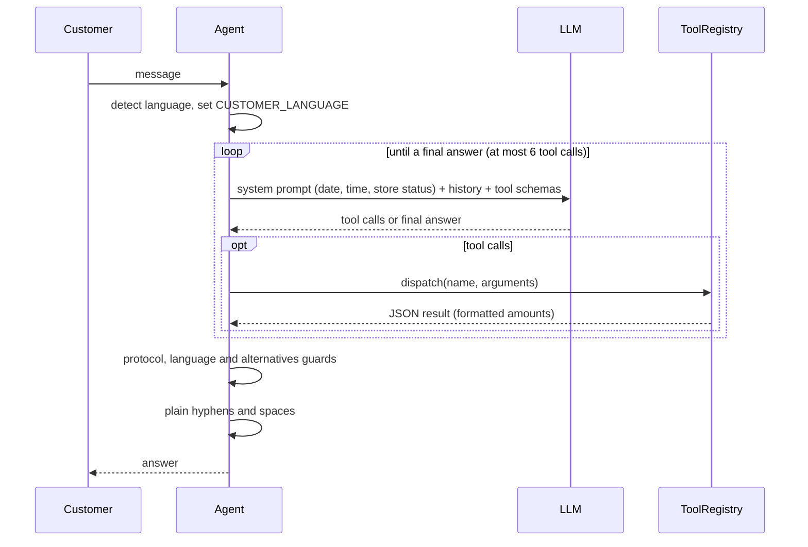

# Architecture

Mel is a small function-calling loop: the model decides **what** to look up and writes the
answer; tested Python code decides **how much** (every amount, deadline and store-hours phrase
reaches the model already formatted). The reasons behind each choice are in
[`DECISIONS.md`](../DECISIONS.md).

## Modules

One flat package, `src/emporio/`:

| Module | Responsibility |
| --- | --- |
| `money.py` | Exact BRL amounts with `Decimal`, "R$ 2.199,00" formatting |
| `models.py` | Pydantic entities and enums (product availability, order status and payment labels) |
| `store_data.py` | Loads the 6 CSVs, normalizes specs, fuzzy product search |
| `services.py` | Every business rule of the manual, pure and tested: pricing, installments, shipping, return windows, delays, identity check, store hours; customer language detection |
| `policies.py` | The manual (converted to Markdown) retrieved by topic |
| `tools.py` | The 5 tools, their JSON schemas and dispatch |
| `llm.py` | Provider-independent `LLMClient` protocol + OpenAI-compatible adapter |
| `agent.py` | Tool-calling loop, session history, protocol, language and alternatives guards |
| `cli.py` | Terminal chat (`typer` + `rich`) |
| `prompts/system.md` | Mel's system prompt |

## The five tools

Arguments are validated by Pydantic; an invalid call returns an error to the model instead of
raising. Money is always returned as formatted text.

| Tool | When the model uses it | Arguments | Main result |
| --- | --- | --- | --- |
| `search_products` | Which instruments exist in a category, price range or with a feature | `category`, `min_price`, `max_price`, `text`, `string_material`, `electric`, `on_sale_only`, `include_unavailable` | Up to 15 products, cheapest first, each with `price_display`, `pix_display` (absent with an active promotion) and `installments_display` |
| `get_product_details` | Price, PIX, installments, promotion, availability, delivery and alternatives of one product | `product_id` or `query` (typos allowed) | `found` with pricing, inactive promotions, local delivery and up to 3 alternatives; or `ambiguous` with candidates; or `not_found` |
| `get_order_status` | Status, tracking, delay and return/warranty deadlines of an order | `order_id` and `email` or `phone` | Order, delay assessment and return windows; the same error for an unknown order and a wrong contact |
| `get_store_policy` | Hours, payment, returns, shipping, promotions, warranty, privacy, contact, scope | `topic` | Manual text for the topic; for `promotions`, also the active seasonal campaigns |
| `escalate_to_human` | Complaints, delayed orders, special freight quotes, privacy requests, anything without a safe answer | `reason`, `summary`, `order_id` | Protocol `EM-YYYYMMDD-NNNN`, response time, next opening when closed, store contacts; one masked line appended to the local log |

## One turn

The system prompt is rebuilt on every turn with the current date, time and store status (open
until, or next opening), because without it the model gets "are you open?" wrong. More than 6
tool calls in a turn returns a fallback that offers a human. An LLM error returns a friendly
message with the store contacts; when the provider's usage quota is used up, Mel says so and
when to try again, and `--trace` shows the technical reason.

`llm.py` retries HTTP 429, 502 and 503 up to 3 attempts (waits of 1 s and 2 s, `Retry-After`
honoured up to 60 s), and retries a reply that is empty or degenerate (mostly symbols or
invisible characters) within the same attempts.

## Guards

Three deterministic checks run on the final answer, because the model ignored the matching prompt
rule during the scenario runs. Each is a regex or word check, not a second model, and costs one
extra call only when it fires. The retry instruction is sent to the model but never stored in the
history.

- **Protocol guard:** an answer that mentions a protocol when `escalate_to_human` did not return
  one in the conversation, or that cites a code the tool never returned, is retried once with an
  instruction to call the tool. A second miss returns the store contacts instead.
- **Language guard:** a Portuguese answer to an English conversation is retried once with an
  instruction to answer in English. A second Portuguese draft is kept, since it is still correct.
- **Alternatives guard:** when `get_product_details` returned an unavailable product with
  alternatives in the turn and the answer names none of them (brand and model, such as "Shelby
  SGD-195E"), the answer is retried once with an instruction to present them. A second miss is
  kept.

## Customer language

`detect_language` (in `services.py`) counts function words that exist in only one of the two
languages; it returns `en` or `pt` when one has at least two words and more than the other, and
`None` for short or ambiguous text such as "ok" or a product name. The agent keeps the previous
language on `None` and starts in Portuguese.

The phrases written by the code follow that language: the next opening (in the store status
line and in the escalation result), the escalation response time, and the order status and
payment labels. Tools read the language from a `ContextVar` (`CUSTOMER_LANGUAGE`) that the agent
sets for the duration of each turn and resets afterwards. This keeps the tool interface
(`run(args)`) and the module boundaries unchanged: no tool gains a language argument the model
could fill in wrongly, and tests can set the variable directly. Price strings ("sem juros"),
delivery texts and the manual stay in Portuguese.
